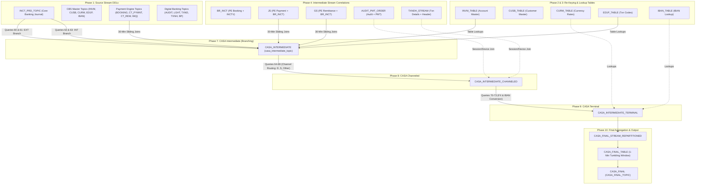
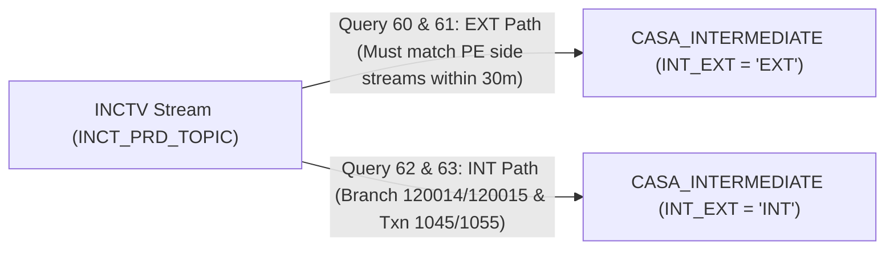
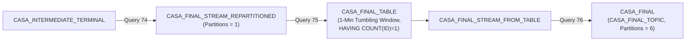

# ksqlDB Query Reference & Pipeline Documentation

This document provides a comprehensive breakdown of all 76 ksqlDB queries defined in [`ksql_deploy_queries.sql`](file:///home/nandan-plf/NBB-analysis/ksql_deploy_queries.sql). It details the flow of data from raw source topics (Core Banking CBS, Digital Banking, and Payment Engine) to intermediate streams, lookup tables, and the final output topic (`CASA_FINAL_TOPIC`).

---

## 🏗️ High-Level Pipeline Architecture

The processing topology is organized into **10 sequential phases**:

---

## 📋 Phase-by-Phase Query Documentation

---

### Phase 1 — Source Stream DDLs (`Queries [01] – [22]`)
*These statements register Kafka topics as readable ksqlDB streams without altering underlying topic data.*

| Query # | Stream Name | Target Kafka Topic | Format | Description |
| :--- | :--- | :--- | :--- | :--- |
| **`[01]`** | `AUDIT_MESSAGE` | `PRD_DIGITAL_AUDIT_MESSAGE_DATA` | JSON | Raw digital banking audit event stream. |
| **`[02]`** | `AUDIT_MESSAGE_METADATA_STREAM` | `PRD_DIGITAL_AUDIT_MESSAGE_DATA_LOB` | JSON | Extended audit event stream containing session metadata & JSON payload strings. |
| **`[03]`** | `BOOKING_REQUEST_STREAM` | `PRD_PE_BOOKING_REQUEST_DATA` | JSON | Payment Engine (PE) transaction booking request events. |
| **`[04]`** | `BP_STREAM` | `PRD_DIGITAL_BP_DATA` | JSON | Beneficiary Profile registration and management events. |
| **`[05]`** | `CMST_STREAM` | `PRD_SBOB_CUSTOM_USER_MASTER_DATA` | JSON | Customer session master records containing channel, user ID, and device metrics. |
| **`[06]`** | `CT_PYMNT_STREAM` | `PRD_PE_CT_PYMNT_DATA` | JSON | PE Credit Transfer Payment detailed payload (beneficiary account, bank reference). |
| **`[07]`** | `CT_REM_STREAM` | `PRD_PE_CT_REM_DATA` | JSON | PE Credit Transfer Remittance detailed payload (ordering customer name, clearing type). |
| **`[08]`** | `CURM_STREAM` | `PRD_CBS_CURM_DATA` | JSON | Core Banking System (CBS) Currency exchange rate updates. |
| **`[09]`** | `CUSB_STREAM` | `PRD_CBS_CUSB_DATA` | JSON | CBS Customer Master Profile updates (full name, staff flag). |
| **`[10]`** | `CVRD_STREAM` | `PRD_SBOB_CUSTOM_USER_VERIFICATION_DATA` | JSON | User verification events (device registration, forgot username flows). |
| **`[11]`** | `ED1P_STREAM` | `PRD_CBS_ED1P_DATA` | JSON | CBS Transaction Code Reference master data (transaction descriptions). |
| **`[12]`** | `EN_USER_STREAM` | `PRD_DIGITAL_EN_USER_DATA` | JSON | Digital Banking user account profiles. |
| **`[13]`** | `FDTT_STREAM` | `PRD_SBOB_CUSTOM_FILE_DETAILS_DATA` | JSON | Bulk file upload details (e.g. beneficiary batch file processing). |
| **`[14]`** | `IBAN_STREAM` | `PRD_CBS_IBAN_DATA` | JSON | CBS Account to IBAN mapping table feed. |
| **`[15]`** | `INCMNG_MSG_QUEUE_STREAM` | `PRD_PE_INCMNG_MSG_QUEUE_DATA` | JSON | PE Incoming Message Queue events containing Channel IDs. |
| **`[16]`** | `INCTV` | `INCT_PRD_TOPIC` | JSON | **Primary Source**: CBS Transaction Journal stream (debit/credit records, amounts, balances). |
| **`[17]`** | `INVM_STREAM` | `PRD_CBS_INVM_DATA` | JSON | CBS Account Master Feed (account status, currency, account type). |
| **`[18]`** | `LGHT_STREAM` | `PRD_SBOB_CUSTOM_USER_LOGIN_HISTORY_DATA` | JSON | Digital Banking User login history events. |
| **`[19]`** | `PMT_ORDER_STREAM` | `PRD_DIGITAL_PMT_ORDER_DATA` | JSON | Digital Banking Payment Order status updates. |
| **`[20]`** | `TXND_STREAM` | `PRD_SBOB_TXND_DATA` | JSON | Digital Banking Transaction Details (host reference, external reference). |
| **`[21]`** | `TXNH_STREAM` | `PRD_SBOB_TXN_HDR_DATA` | JSON | Digital Banking Transaction Header (corporate user ID, transaction status). |
| **`[22]`** | `CASA_FINAL_STREAM_FROM_TABLE` | `CASA_FINAL_TBL_TOPIC` | JSON | Source stream DDL mapped onto the intermediate materialized table topic. |

---

### Phase 2 — Keying Streams (`Queries [23] – [29]`)
*These streams re-partition source streams by specific primary key fields to enable stateful Table joins.*

* **`[23] CMST_WITH_KEY`**: Partitioned by `BAY_USER_ID`. Prepares customer session data for table materialization.
* **`[24] EN_USER_WITH_KEY1`**: Partitioned by `LCASE(EXTERNAL_ID)`. Case-insensitive re-keying for digital users.
* **`[25] CURM_WITH_KEY`**: Partitioned by 3-character Currency Code (`SUBSTRING(KEY_1, 4, 3)`). Prepares rate lookups.
* **`[26] CUSB_WITH_KEY`**: Partitioned by `CUSTOMER_NO`. Prepares customer profile lookups.
* **`[27] IBAN_WITH_KEY`**: Partitioned by `ACCT_NO`. Prepares IBAN mapping lookups.
* **`[28] INVM_WITH_KEY`**: Partitioned by 16-digit Account Number (`SUBSTRING(KEY_1, 4, 16)`). Prepares account master lookups.
* **`[29] ED1P_WITH_KEY`**: Partitioned by `TRAN_CODE`. Prepares transaction code description lookups.

---

### Phase 3 — Lookup Tables (`Queries [30] – [37]`)
*Materializes keyed streams into stateful lookup Tables for fast `LEFT/INNER JOIN` operations.*

* **`[30] CMST_TABLE`**: Materialized table of active customer session metadata.
* **`[31] LEGAL_ENTITY_TABLE`**: Table of corporate/legal entities.
* **`[32] EN_USER_TABLE1`**: Table of digital user identities.
* **`[33] CURM_TABLE`**: Materialized exchange rate table indexed by currency code.
* **`[34] ED1P_TABLE`**: Transaction code description table indexed by transaction code.
* **`[35] CUSB_TABLE`**: Customer profile table indexed by customer number.
* **`[36] IBAN_TABLE`**: Account-to-IBAN translation table indexed by account number.
* **`[37] INVM_TABLE`**: Core banking account master table indexed by 16-digit account number.

---

### Phase 4 — Derived Intermediate Streams (`Queries [38] – [51]`)
*Performs early-stage windowed joins and payload transformations across multiple source topics.*

* **`[38] LGHT_REQUEST`**: Flattens `LGHT_STREAM` login history fields.
* **`[39] BP_REQUEST`**: Extracts beneficiary CPR, phone number, and validation flags.
* **`[40] IBAN_REQUEST`**: Maps `CUSTOMER_NO` to `IBAN_NO`.
* **`[41] BPAY_NEW`**: Joins `BP_REQUEST` with `IBAN_REQUEST` (within 1 minute) to process bill payment beneficiary creations.
* **`[42] TXND_REQUEST`**: Flattens digital transaction details.
* **`[43] TXNH_REQUEST`**: Flattens digital transaction headers.
* **`[44] TXNDH_STREAM`**: Joins transaction details `TXND_STREAM` with headers `TXNH_STREAM` within a **30-minute window** on `TXN_ID`.
* **`[45] BOOKING_REQUEST_STREAM_REQUEST`**: Extracts PE booking details (`TXN_POS_NUM`, `ACNTG_REF`).
* **`[46] CT_PYMNT_REQUEST`**: Extracts PE credit payment details (`BEN_ACNT`, `UNQ_SEQ_NUM`).
* **`[47] CT_REM_REQUEST`**: Extracts PE credit remittance details (`ORD_CUST_NM`, `INSTRMNT_ID`).
* **`[48] AUDIT_PMT_ORDER`**: Joins base64-encoded audit messages with `PMT_ORDER_STREAM` (within 30 minutes) to extract JSON fields (`Geolocation`, `Device ID`, `Session ID`).
* **`[49] BR_INCT`**: **Core PE Join**: Joins `BOOKING_REQUEST_STREAM` with Core Banking stream `INCTV` within **30 minutes** on `GEN_DT + ACNTG_REF = POST_DATE + JRNL_NO`. Repartitions by `TXN_POS_NUM`.
* **`[50] JS`**: Joins PE Credit Transfer Payment stream (`CT_PYMNT_STREAM`) with `BR_INCT` within **30 minutes** on `TXN_POS_NUM`. Produces payment destination details.
* **`[51] GS`**: Joins PE Credit Transfer Remittance stream (`CT_REM_STREAM`) with `BR_INCT` within **30 minutes** on `TXN_POS_NUM`. Produces ordering customer & clearing type details.

---

### Phase 5 — Final Output Streams (`Queries [52] – [56]`)
*Processes standalone side-streams for non-CASA reporting (login, registration, audit events).*

* **`[52] SB1`**: Captures "Forgot Username" events by joining verification stream `CVRD_STREAM` with `CMST_TABLE`.
* **`[53] SB2`**: Captures "Device Registration" events by joining `CVRD_STREAM` with `CMST_TABLE`.
* **`[54] SB4`**: Processes beneficiary file upload events ("BEN") from `FDTT_STREAM`.
* **`[55] AUDIT_FINAL_NEW`**: Emits user activity audit events (Logins, PIN changes, Onboarding) by joining audit streams with user and legal entity tables.
* **`[56] SB3`**: Processes user logout/login history events ("LO") from `LGHT_REQUEST` and `CMST_TABLE`.

---

### Phase 6 — CASA Pipeline Schema DDLs (`Queries [57] – [59]`)
*Declares topic schemas for the multi-stage CASA processing pipeline.*

* **`[57] CASA_INTERMEDIATE`**: Schema DDL for `casa_intermediate_topic` (Partitions: 6).
* **`[58] CASA_INTERMEDIATE_CHANNELED`**: Schema DDL for `casa_intermediate_channeled_topic` (Partitions: 6).
* **`[59] CASA_INTERMEDIATE_TERMINAL`**: Schema DDL for `casa_intermediate_terminal_topic` (Partitions: 6).

---

### Phase 7 — Ingestion into `CASA_INTERMEDIATE` (`Queries [60] – [63]`)
*Splits incoming core banking transactions (`INCTV`) into External (`EXT`) vs. Internal (`INT`) execution paths.*

#### Query Details:
* **`[60] CASA_INTERMEDIATE (External Path 1)`**:
  * **Criteria**: `INT_EXT = 'EXT'`.
  * **Joins**: `INCTV` + `GS` (within 30m) + `INVM_TABLE` + `JS` (within 30m) + `INCMNG_MSG_QUEUE_STREAM` (joined via `GS.C_TXN_POS_NUM`).
  * **Purpose**: Captures external transfer transactions initiated via PE where queue position number correlates with remittance details.
* **`[61] CASA_INTERMEDIATE (External Path 2)`**:
  * **Criteria**: `INT_EXT = 'EXT'`.
  * **Joins**: Identical to `[60]`, but joins `INCMNG_MSG_QUEUE_STREAM` via `JS.C_TXN_POS_NUM`.
* **`[62] CASA_INTERMEDIATE (Internal Path 1)`**:
  * **Criteria**: `INT_EXT = 'INT'`.
  * **Filter**: `WHERE SUBSTRING(TELL_BR, 1, 6) = '120015' AND TRAN_CODE IN ('1045', '1055')`.
  * **Joins**: `INCTV` + `INVM_TABLE` + `ED1P_TABLE`. Assigns `CHANNEL_ID = 'D'` (Digital).
* **`[63] CASA_INTERMEDIATE (Internal Path 2)`**:
  * **Criteria**: `INT_EXT = 'INT'`.
  * **Filter**: `WHERE SUBSTRING(TELL_BR, 1, 6) = '120014' AND TRAN_CODE IN ('1045', '1055')`.
  * **Joins**: `INCTV` + `INVM_TABLE` + `ED1P_TABLE`. Assigns `CHANNEL_ID = 'S'` (Self-Service).

---

### Phase 8 — Ingestion into `CASA_INTERMEDIATE_CHANNELED` (`Queries [64] – [69]`)
*Enriches intermediate transactions with channel metadata (Digital, Self-Service, Core) and customer details.*

* **`[64] CASA_INTERMEDIATE_CHANNELED (Channel D - External)`**:
  * Filters `CHANNEL_ID = 'D'` & `INT_EXT = 'EXT'`.
  * Left joins `AUDIT_PMT_ORDER` (within 30m) on `JOURNAL_NO = BANK_REFERENCE_ID` to attach session ID, device ID, and geo-coordinates.
* **`[65] CASA_INTERMEDIATE_CHANNELED (Channel D - Internal)`**:
  * Filters `CHANNEL_ID = 'D'` & `INT_EXT = 'INT'`.
  * Inner joins counterparty `INCTV` record (within 30m) on `JOURNAL_NO`, looks up counterparty name in `CUSB_TABLE`, and left joins `AUDIT_PMT_ORDER`.
* **`[66] CASA_INTERMEDIATE_CHANNELED (Channel S - External)`**:
  * Filters `CHANNEL_ID = 'S'` & `INT_EXT = 'EXT'`.
  * Left joins digital transaction details `TXNDH_STREAM` (within 30m) on `UNQ_SEQ_NUM = EXTERNAL_REF_NO`.
* **`[67] CASA_INTERMEDIATE_CHANNELED (Channel S - Internal)`**:
  * Filters `CHANNEL_ID = 'S'` & `INT_EXT = 'INT'`.
  * Inner joins counterparty `INCTV` (within 30m), looks up `CUSB_TABLE`, and left joins `TXNDH_STREAM` on `JOURNAL_NO = HOST_REF_NO`.
* **`[68] CASA_INTERMEDIATE_CHANNELED (Other Channels - External)`**:
  * Filters `CHANNEL_ID NOT IN ('D', 'S')` & `INT_EXT = 'EXT'`. Pass-through without digital session enrichment.
* **`[69] CASA_INTERMEDIATE_CHANNELED (Other Channels - Internal)`**:
  * Filters `CHANNEL_ID NOT IN ('D', 'S')` & `INT_EXT = 'INT'`. Joins counterparty `INCTV` and looks up `CUSB_TABLE`.

---

### Phase 9 — Ingestion into `CASA_INTERMEDIATE_TERMINAL` (`Queries [70] – [73]`)
*Handles currency conversion (FX rates to local BHD currency) and counterparty IBAN resolution.*

* **`[70] CASA_TERMINAL (External - Foreign Currency)`**:
  * Filters `INT_EXT = 'EXT'` & `CURRENCY <> 'BHD'`.
  * Inner joins exchange rate table `CURM_TABLE` on currency code and computes `AMOUNT_IN_LOC_CURR = AMOUNT * RATE_MID`.
* **`[71] CASA_TERMINAL (External - Local Currency BHD)`**:
  * Filters `INT_EXT = 'EXT'` & `CURRENCY = 'BHD'`.
  * Passes through amounts directly (`AMOUNT_IN_LOC_CURR = AMOUNT`).
* **`[72] CASA_TERMINAL (Internal - Foreign Currency)`**:
  * Filters `INT_EXT = 'INT'` & `CURRENCY <> 'BHD'`.
  * Inner joins `CURM_TABLE` for FX conversion AND inner joins `IBAN_TABLE` on `INT_ACCT_NO` to resolve counterparty IBAN. Requires `INT_POST_DATE = POST_DATE` and `INT_ACCT_NO <> TRAN_ACC_NO`.
* **`[73] CASA_TERMINAL (Internal - Local Currency BHD)`**:
  * Filters `INT_EXT = 'INT'` & `CURRENCY = 'BHD'`.
  * Inner joins `IBAN_TABLE` to resolve counterparty IBAN without FX conversion.

---

### Phase 10 — CASA Final Pipeline (`Queries [74] – [76]`)
*Performs single-partition re-keying, tumbling window deduplication, and final output publishing.*

* **`[74] CASA_FINAL_STREAM_REPARTITIONED`**:
  * **Type**: Stream (`kafka_topic = 'CASA_FINAL_STREAM_REPARTITIONED'`).
  * **Configuration**: `partitions = 1`, `value_format = 'JSON'`.
  * **Function**: Trims all string attributes and repartitions all records onto a single partition indexed by transaction composite `ID`.
* **`[75] CASA_FINAL_TABLE`**:
  * **Type**: Materialized Derived Table (`kafka_topic = 'CASA_FINAL_TBL_TOPIC'`).
  * **Window Logic**: `WINDOW TUMBLING (SIZE 1 MINUTES, RETENTION 12 HOURS, GRACE PERIOD 30 MINUTES)`.
  * **Aggregation**: Groups by `ID`, selects `LATEST_BY_OFFSET(...)` for all transaction fields, and enforces **`HAVING COUNT(ID) = 1`**.
  * **Function**: Deduplicates incoming CDC transaction events within a 1-minute window. If a transaction key appears more than once, it is suppressed to prevent duplicate publishing.
* **`[76] CASA_FINAL`**:
  * **Type**: Final Output Stream (`kafka_topic = 'CASA_FINAL_TOPIC'`).
  * **Configuration**: `partitions = 6`, `key_format = 'KAFKA'`, `value_format = 'JSON'`.
  * **Function**: Reads non-null records from `CASA_FINAL_STREAM_FROM_TABLE` (which streams off `CASA_FINAL_TBL_TOPIC`), re-partitions by `ID` across 6 partitions, and emits final clean transaction events to **`CASA_FINAL_TOPIC`**.

---

## 🔍 Key Data Flow Summary Matrix

| Stage | Input Stream/Table | Output Target | Key Logic / Condition |
| :--- | :--- | :--- | :--- |
| **Ingestion** | `INCT_PRD_TOPIC` | `INCTV` Stream | Raw core banking journal ingestion |
| **PE Correlation** | `BOOKING_REQUEST` + `INCTV` | `BR_INCT` Stream | 30-min window join on `GEN_DT+ACNTG_REF = POST_DATE+JRNL_NO` |
| **CASA Branching (EXT)** | `INCTV` + `GS` + `JS` + `IMQ` | `CASA_INTERMEDIATE` | Requires 4-way PE stream joins within 30m |
| **CASA Branching (INT)** | `INCTV` + `INVM` + `ED1P` | `CASA_INTERMEDIATE` | Filters `TRAN_CODE IN ('1045','1055')` & Branch `'120014'/'120015'` |
| **Channel Routing** | `CASA_INTERMEDIATE` | `CASA_INTERMEDIATE_CHANNELED` | Attaches digital audit session, device & geo data |
| **FX & IBAN** | `CASA_INTERMEDIATE_CHANNELED` | `CASA_INTERMEDIATE_TERMINAL` | Converts non-BHD via `CURM_TABLE` & resolves IBAN via `IBAN_TABLE` |
| **Deduplication** | `CASA_INTERMEDIATE_TERMINAL` | `CASA_FINAL_TABLE` | 1-min Tumbling Window, `HAVING COUNT(ID)=1` |
| **Final Output** | `CASA_FINAL_STREAM_FROM_TABLE` | `CASA_FINAL_TOPIC` | Emits deduplicated transactions to 6-partition target topic |
