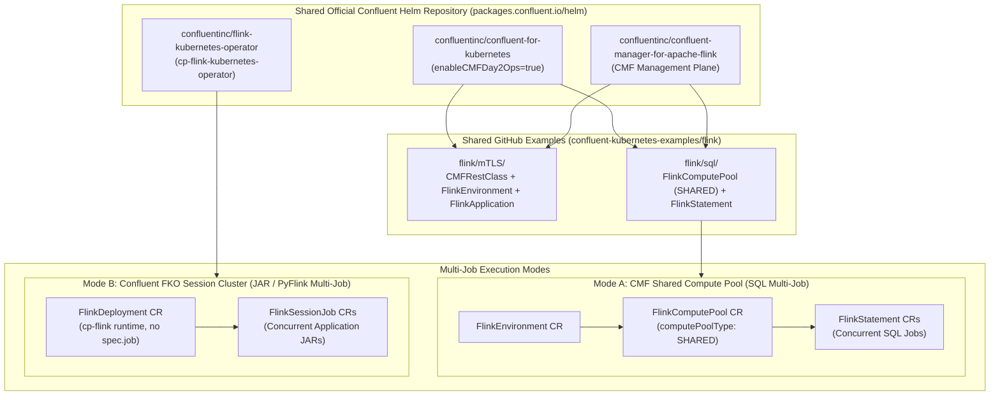
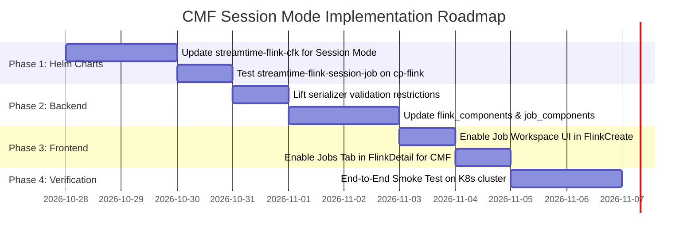

# Implementation Plan: Confluent Flink (CMF) Session & Multi-Job Cluster Mode

## Executive Summary

Based on the shared official Confluent documentation, Helm charts ([`packages.confluent.io/helm`](https://packages.confluent.io/helm)), and repository examples from [`confluentinc/confluent-kubernetes-examples`](https://github.com/confluentinc/confluent-kubernetes-examples/tree/master/flink), this plan outlines the architecture and implementation steps to enable **Session Mode / Multi-Job Cluster Mode** for Confluent Flink (`cmf`) in Fleet Manager.

Currently, Fleet Manager implements Session Mode ("Job Workspace") exclusively for **Apache Flink (`open-source`)** using upstream `FlinkDeployment` and `FlinkSessionJob` CRDs. For **Confluent Flink (`cmf`)**, the system currently enforces single-job Application Mode (`FlinkApplication`), blocking Session Mode in the backend validation rules and frontend UI.

By examining the shared Confluent Helm charts (`confluent-for-kubernetes`, `confluent-manager-for-apache-flink`, and `flink-kubernetes-operator`) and reference manifests, this document presents the concrete design to achieve full multi-job cluster support for CMF.

---

## 1. Reference Architecture from Shared Confluent Assets

The shared official Confluent assets define three primary Helm charts and two distinct execution mechanisms for multi-job workloads:

### 1.1 Shared Confluent Helm Charts (`https://packages.confluent.io/helm`)

1. **`confluentinc/confluent-for-kubernetes` (CFK)**:
   - Deploys the CFK Operator.
   - When configured with `--set enableCMFDay2Ops=true`, reconciles CMF-specific Custom Resources: `CMFRestClass`, `FlinkEnvironment`, `FlinkApplication`, `FlinkComputePool`, and `FlinkStatement`.
2. **`confluentinc/confluent-manager-for-apache-flink` (CMF)**:
   - Control plane managing environments, SQL statement executions, and metadata persistence (local SQLite or external JDBC/PostgreSQL).
   - Exposes REST endpoints (`/cmf/api/v1/environments/...`) and Web UI.
3. **`confluentinc/flink-kubernetes-operator` (`cp-flink-kubernetes-operator`)**:
   - Confluent's distribution of the Apache Flink Kubernetes Operator (FKO).
   - Reconciles standard `flink.apache.org/v1beta1` resources (`FlinkDeployment`, `FlinkSessionJob`) using enterprise Confluent images (`docker.io/confluentinc/cp-flink:1.19.3-cp6`).



---

## 2. Technical Evaluation of Confluent Multi-Job Execution

The shared reference configurations demonstrate that Confluent supports multi-job execution via two distinct paths:

### 2.1 Mode A: CMF Shared Compute Pools (`FlinkComputePool` + `FlinkStatement`)
From the shared [`flink/sql`](https://github.com/confluentinc/confluent-kubernetes-examples/tree/master/flink) manifests and CMF specifications:
- **`FlinkApplication` (`platform.confluent.io/v1beta1`)** is strictly dedicated to **Application Mode** (one isolated Flink cluster per application JAR; requires `spec.job.jarURI`).
- Multi-job session capability inside CMF is implemented via **Shared Compute Pools**:
  - A `FlinkComputePool` custom resource with `computePoolType: SHARED` boots a long-lived, multi-tenant Flink session cluster managed by CMF.
  - Multiple `FlinkStatement` resources reference this pool (`spec.flinkComputePoolRef.name`), running streaming SQL queries concurrently within the shared TaskManager slots.
- **Reference Manifests**:
  ```yaml
  apiVersion: platform.confluent.io/v1beta1
  kind: FlinkComputePool
  metadata:
    name: shared-session-pool
    namespace: confluent
  spec:
    flinkEnvironmentRef:
      name: default-env
    computePoolType: SHARED
    clusterSpec:
      image: confluentinc/cp-flink:1.19.3-cp6
      jobManager:
        resource:
          cpu: 1
          memory: "2Gi"
      taskManager:
        replicas: 2
        resource:
          cpu: 1
          memory: "2Gi"
  ---
  apiVersion: platform.confluent.io/v1beta1
  kind: FlinkStatement
  metadata:
    name: sql-job-1
    namespace: confluent
  spec:
    flinkEnvironmentRef:
      name: default-env
    flinkComputePoolRef:
      name: shared-session-pool
    statement: |
      INSERT INTO sink_topic SELECT * FROM source_topic;
  ```

### 2.2 Mode B: Confluent FKO Session Cluster (`cp-flink-kubernetes-operator`)
From the shared Helm chart [`confluentinc/flink-kubernetes-operator`](https://packages.confluent.io/helm):
- Confluent packages the standard Apache Flink Kubernetes Operator under `cp-flink-kubernetes-operator`.
- In Fleet Manager, when `Stream Processing → Confluent Flink (cmf)` is enabled on a fleet, the bootstrap resolver ([`bootstrap_resolver.py`](file:///home/nandan-plf/streamtime/flink-cmf-session/fleet-manager/fleet-manager-backend/core/services/bootstrap_resolver.py#L94-L110)) **already installs** `cp_flink_operator` alongside `cfk` and `cmf`.
- This operator natively supports Apache Flink Session Mode:
  - **Cluster**: A `FlinkDeployment` resource without `spec.job`, using the enterprise Confluent image `docker.io/confluentinc/cp-flink:1.19.3-cp6`.
  - **Jobs**: Multiple `FlinkSessionJob` resources targeting `spec.deploymentName`, executing Java/Scala JARs or Python archives.
- **Benefits**: Seamlessly matches Fleet Manager's existing `FlinkJob` model, schemas, UI workflows, and `streamtime-flink-session-job` Helm chart.

---

## 3. Comparison Matrix

| Feature / Behavior | Mode A: CMF Shared Compute Pool (`FlinkComputePool`) | Mode B: Confluent FKO Session Cluster (`cp-flink` Session) |
|---|---|---|
| **Workload Type** | Flink SQL statements (`FlinkStatement` / CMF SQL API). | Custom packaged Java/Scala JARs & PyFlink zips. |
| **CRDs** | `platform.confluent.io/v1beta1` (`FlinkComputePool`, `FlinkStatement`). | `flink.apache.org/v1beta1` (`FlinkDeployment`, `FlinkSessionJob`). |
| **Underlying Controller** | Confluent for Kubernetes (CFK) + CMF REST API. | `cp-flink-kubernetes-operator` (Confluent FKO). |
| **Fleet Manager Parity** | Requires a new model/CRUD for statements or mapping `FlinkJob` to statements. | Direct 1:1 drop-in parity with existing `FlinkJob` model, serializer, and UI. |
| **Web UI Visibility** | Confluent Manager for Apache Flink Web UI (`cmf_ui`). | Standard Flink Web UI (`flink_ui`) + Fleet Grafana Dashboards. |
| **Status in Fleet Bootstrap** | Supported via CFK (`cfk` component). | Supported via Confluent FKO (`cp_flink_operator` component). |

> [!NOTE]
> **Recommended Strategy**: Implement **Mode B** (Confluent FKO Session Cluster) first to give users instant multi-job JAR submission parity on Confluent Flink without modifying the core `FlinkJob` model. Then add **Mode A** (`FlinkComputePool`) as part of a dedicated Flink SQL Workspace feature.

---

## 4. End-to-End Implementation Plan for Fleet Manager

### 4.1 Helm Charts Updates

#### 1. Update `charts/streamtime-flink-cfk`
In [`charts/streamtime-flink-cfk/templates`](file:///home/nandan-plf/streamtime/flink-cmf-session/fleet-manager/charts/streamtime-flink-cfk/templates):
- **For Mode B (Session Deployment)**:
  - When `.Values.flink.mode == "session"`, render a session-mode `FlinkDeployment` without `spec.job` using `.Values.flink.image` (`confluentinc/cp-flink:1.19.3-cp6`) and Confluent licensing.
  - When `.Values.flink.mode == "application"`, continue rendering `FlinkApplication` with `spec.job`.
- **For Mode A (Shared Compute Pool)**:
  - Add `templates/flink-compute-pool.yaml`:
    ```yaml
    {{- if eq .Values.flink.mode "session" }}
    apiVersion: platform.confluent.io/v1beta1
    kind: FlinkComputePool
    metadata:
      name: {{ .Release.Name }}
      namespace: {{ .Release.Namespace }}
    spec:
      flinkEnvironmentRef:
        name: {{ .Values.flink.flink_environment | default .Release.Name }}
      computePoolType: SHARED
      clusterSpec:
        image: {{ .Values.flink.image | quote }}
        jobManager:
          resource:
            cpu: {{ .Values.flink.jobmanager_resources.requests.cpu | quote }}
            memory: {{ .Values.flink.jobmanager_resources.requests.memory | quote }}
        taskManager:
          replicas: {{ .Values.flink.taskmanager_replicas | default 1 }}
          resource:
            cpu: {{ .Values.flink.taskmanager_resources.requests.cpu | quote }}
            memory: {{ .Values.flink.taskmanager_resources.requests.memory | quote }}
    {{- end }}
    ```

#### 2. Update `charts/streamtime-flink-session-job`
- In [`charts/streamtime-flink-session-job/templates/flinksessionjob.yaml`](file:///home/nandan-plf/streamtime/flink-cmf-session/fleet-manager/charts/streamtime-flink-session-job/templates/flinksessionjob.yaml):
  - Ensure compatibility with Confluent `cp-flink` classpaths, Confluent Kafka SASL/mTLS credentials, and Schema Registry configurations.

---

### 4.2 Backend Core Updates

#### 1. Relax Serializer Constraints ([`core/serializers.py`](file:///home/nandan-plf/streamtime/flink-cmf-session/fleet-manager/fleet-manager-backend/core/serializers.py#L7998-L8002))
- Remove the legacy validation restriction blocking CMF session mode:
  ```diff
  -        provider = self.instance.provider if self.instance else attrs.get("provider", "open-source")
  -        if provider == "cmf" and mode != "application":
  -            raise serializers.ValidationError(
  -                {"provider": "The 'cmf' provider currently only supports 'application' mode."}
  -            )
  ```
- In `FlinkJobSerializer.validate` ([line 8540+](file:///home/nandan-plf/streamtime/flink-cmf-session/fleet-manager/fleet-manager-backend/core/serializers.py#L8540)):
  - Allow `FlinkJob` submission when parent `flink.provider == "cmf"` and `flink.mode == "session"`.

#### 2. Runtime Values Resolution ([`core/services/flink_components.py`](file:///home/nandan-plf/streamtime/flink-cmf-session/fleet-manager/fleet-manager-backend/core/services/flink_components.py#L320-L480))
- In `FlinkComponentsService._build_runtime_values`:
  - When `flink.provider == "cmf"` and `flink.mode == "session"`:
    - Omit `runtime["flink"]["application_jar"]`.
    - Set `runtime["flink"]["mode"] = "session"`.
    - Apply `max_flink_units` sizing into JobManager/TaskManager resource definitions.
    - Expose HTTPRoute for Flink Web UI (`flink-ui-{flink.identifier}.{domain}`) or route via CMF gateway.

#### 3. Flink Job Component Resolution ([`core/services/flink_job_components.py`](file:///home/nandan-plf/streamtime/flink-cmf-session/fleet-manager/fleet-manager-backend/core/services/flink_job_components.py#L215-L265))
- In `FlinkJobComponentsService._build_runtime_values`:
  - Format `job.clusterName` to match the CMF session cluster name.
  - Forward Confluent license secret references and Kafka client security credentials if needed.

#### 4. Provider Capability Registration ([`core/views/shared/configuration_profiles.py`](file:///home/nandan-plf/streamtime/flink-cmf-session/fleet-manager/fleet-manager-backend/core/views/shared/configuration_profiles.py#L153))
- Confirm `capabilities: ["application", "session"]` is maintained for `cmf` and exposed across SKU inspection endpoints.

---

### 4.3 Frontend UI Adjustments

#### 1. Enable Session Mode for CMF ([`FlinkCreate.js`](file:///home/nandan-plf/streamtime/flink-cmf-session/fleet-manager/fleet-manager-frontend/src/features/flink/FlinkCreate.js#L1379-L1455))
- Remove the automatic reset of mode to `application` when `provider === "cmf"` (lines 1379–1381).
- Remove the disabled state, tooltip ("Job Workspace is not supported for CMF"), and `not-allowed` cursor on the "Job Workspace" radio option (lines 1421–1455).

#### 2. Enable Jobs Tab on CMF Session Clusters ([`FlinkDetail.js`](file:///home/nandan-plf/streamtime/flink-cmf-session/fleet-manager/fleet-manager-frontend/src/features/flink/FlinkDetail.js))
- Allow navigating to the **Jobs** tab and submitting new FlinkJobs when `flink.provider === "cmf"` and `flink.mode === "session"`.
- Provide an "Open Flink UI" / "Open CMF UI" button that routes to the active session cluster.

---

### 4.4 Orchestrator and Agent Workflows

1. **Temporal Workflows**:
   - Verify `FlinkCreateWorkflow`, `FlinkUpdateWorkflow`, and `FlinkDeleteWorkflow` in `fleet-manager-orchestrator`:
     - Health check prober: Probes the session JobManager pod readiness before marking the cluster `Healthy`.
     - Cascade teardown: When deleting a CMF session cluster, ensure child `FlinkJob` releases are uninstalled before tearing down the session cluster.
2. **StreamTime Agent**:
   - Ensure `DeployFlinkWorkloadWorkflow` and `DeployFlinkJobWorkflow` properly inspect status conditions on both `FlinkDeployment` and `FlinkSessionJob` for CMF releases.

---

## 5. Implementation Roadmap & Verification Matrix



### Verification Matrix

| Area | Test File / Command | Verification Criteria |
|---|---|---|
| **Backend Unit Tests** | `pytest core/tests/test_flink.py` | Creating a Flink instance with `provider="cmf"` and `mode="session"` succeeds with `max_flink_units`. |
| **Job Backend Tests** | `pytest core/tests/services/test_flink_job_components.py` | Submitting a `FlinkJob` to a `cmf` session cluster resolves `streamtime-flink-session-job` with valid runtime values. |
| **Frontend Tests** | `npm test -- FlinkCreate.test.js` | User can toggle between Single-Job and Job Workspace when CMF is selected. |
| **Helm Render Validation** | `helm template test charts/streamtime-flink-cfk -f test-session-values.yaml` | Renders a valid session cluster manifest without validation errors. |
| **Live Smoke Test** | `python test_smoke_suite.py` | 1. Deploys CMF session cluster.<br/>2. Submits 2 concurrent FlinkJobs.<br/>3. Verifies both jobs execute in parallel on the shared cluster. |
