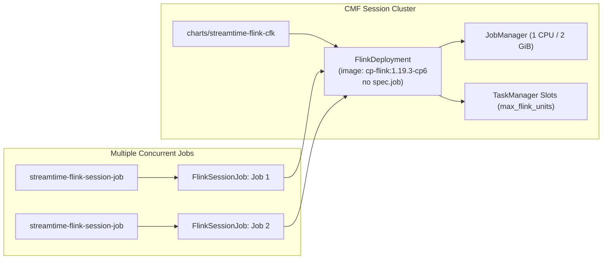

# Ticket 1: CMF Multi-Job Session Mode via Confluent FKO

## 1. Context & Objective

In Fleet Manager, **Apache Flink (`open-source`)** supports Session Mode ("Job Workspace") via upstream `FlinkDeployment` (without `spec.job`) and child `FlinkSessionJob` CRs. 
However, **Confluent Flink (`cmf`)** is currently locked to `mode="application"`:
- Backend serializer ([`core/serializers.py`](file:///home/nandan-plf/streamtime/flink-cmf-session/fleet-manager/fleet-manager-backend/core/serializers.py#L7999)): raises `ValidationError("The 'cmf' provider currently only supports 'application' mode.")`.
- Frontend ([`FlinkCreate.js`](file:///home/nandan-plf/streamtime/flink-cmf-session/fleet-manager/fleet-manager-frontend/src/features/flink/FlinkCreate.js#L1422)): disables "Job Workspace" with tooltip `"Job Workspace is not supported for CMF"`.
- Chart ([`charts/streamtime-flink-cfk`](file:///home/nandan-plf/streamtime/flink-cmf-session/fleet-manager/charts/streamtime-flink-cfk)): always renders `FlinkApplication` with `spec.job`.

### Objective
Leverage Confluent's official distribution of the Apache Flink Kubernetes Operator (`cp-flink-kubernetes-operator`, already bootstrapped on CMF fleets in [`bootstrap_resolver.py`](file:///home/nandan-plf/streamtime/flink-cmf-session/fleet-manager/fleet-manager-backend/core/services/bootstrap_resolver.py#L94-L110)) to enable **immediate Session Mode parity for Confluent Flink**. Operators will be able to provision a CMF session cluster, and Project Owners will be able to submit multiple concurrent Java/Scala/Python `FlinkJob` resources to it.



---

## 2. Scope

### In Scope
- Helm Chart: Support `mode: session` in `streamtime-flink-cfk` by emitting a session `FlinkDeployment` without `spec.job`, configured with `confluentinc/cp-flink` and Confluent license secret.
- Backend Serializers: Remove the `provider == "cmf" and mode != "application"` restriction.
- Runtime Values: Update `FlinkComponentsService` to omit `application_jar` for session clusters, derive TM slots from `max_flink_units`, and inject metrics reporters.
- Session Jobs: Update `FlinkJobComponentsService` to format `job.clusterName` for CMF session clusters and dispatch via `streamtime-flink-session-job`.
- Frontend: Enable the "Job Workspace" option when `provider === "cmf"` in `FlinkCreate.js`; enable the Jobs tab in `FlinkDetail.js`.
- Testing: Comprehensive pytest unit tests and Helm template render tests.

### Out of Scope (Handled in Follow-Up Tickets)
- Deep server-side JAR bytecode inspection (Ticket 2).
- Native CMF REST API artifact synchronization (`cmf://` URIs) (Ticket 3).
- CMF SQL Workspaces via `FlinkComputePool` + `FlinkStatement` (Ticket 4).

---

## 3. Detailed Changes by Component

### 3.1 Helm Chart: `charts/streamtime-flink-cfk`

#### Modify `charts/streamtime-flink-cfk/templates/flink-application.yaml`
Wrap the `FlinkApplication` in a condition: only render when `.Values.flink.mode == "application"` (or when `.Values.flink.application_jar` is present):
```diff
+ {{- if or (eq .Values.flink.mode "application") (and (not .Values.flink.mode) .Values.flink.application_jar) }}
  apiVersion: platform.confluent.io/v1beta1
  kind: FlinkApplication
  metadata:
    name: {{ .Release.Name }}
  ...
+ {{- end }}
```

#### Add `charts/streamtime-flink-cfk/templates/flink-deployment.yaml`
Rendered when `.Values.flink.mode == "session"`:
```yaml
{{- if eq .Values.flink.mode "session" }}
apiVersion: flink.apache.org/v1beta1
kind: FlinkDeployment
metadata:
  name: {{ .Release.Name }}
  namespace: {{ .Release.Namespace }}
  labels:
    app.kubernetes.io/name: {{ .Chart.Name }}
    app.kubernetes.io/instance: {{ .Release.Name }}
spec:
  image: {{ .Values.flink.image | quote }}
  {{- $version := .Values.flink.flink_version | default "1.19" | replace "." "_" }}
  {{- if not (hasPrefix "v" $version) }}
  {{- $version = printf "v%s" $version }}
  {{- end }}
  flinkVersion: {{ $version | quote }}
  serviceAccount: {{ .Values.flink.serviceAccount | default .Release.Name | quote }}
  flinkConfiguration:
    taskmanager.numberOfTaskSlots: {{ .Values.flink.slots_per_taskmanager | default "1" | quote }}
    metrics.reporter.prom.factory.class: org.apache.flink.metrics.prometheus.PrometheusReporterFactory
    metrics.reporter.prom.port: "9249"
    {{- range $k, $v := .Values.flink.flink_conf }}
    {{ $k | quote }}: {{ $v | quote }}
    {{- end }}
  jobManager:
    resource:
      cpu: {{ default "1" .Values.flink.jobmanager_resources.requests.cpu | quote }}
      memory: {{ default "2Gi" .Values.flink.jobmanager_resources.requests.memory | quote }}
    replicas: 1
  taskManager:
    replicas: {{ .Values.flink.taskmanager_replicas | default 1 }}
    resource:
      cpu: {{ default "1" .Values.flink.taskmanager_resources.requests.cpu | quote }}
      memory: {{ default "2Gi" .Values.flink.taskmanager_resources.requests.memory | quote }}
  # NOTE: spec.job is intentionally omitted in session mode.
{{- end }}
```

---

### 3.2 Backend Core

#### 1. [`fleet-manager-backend/core/serializers.py`](file:///home/nandan-plf/streamtime/flink-cmf-session/fleet-manager/fleet-manager-backend/core/serializers.py)
Update `FlinkSerializer.validate`:
```diff
-        provider = self.instance.provider if self.instance else attrs.get("provider", "open-source")
-        if provider == "cmf" and mode != "application":
-            raise serializers.ValidationError(
-                {"provider": "The 'cmf' provider currently only supports 'application' mode."}
-            )
+        provider = self.instance.provider if self.instance else attrs.get("provider", "open-source")
+        # CMF now supports both 'application' and 'session' modes.
```

In `FlinkJobSerializer.validate`:
Ensure `flink.mode == "session"` passes regardless of whether `flink.provider` is `open-source` or `cmf`.

#### 2. [`fleet-manager-backend/core/services/flink_components.py`](file:///home/nandan-plf/streamtime/flink-cmf-session/fleet-manager/fleet-manager-backend/core/services/flink_components.py)
In `_build_runtime_values`:
```python
if flink.provider == "cmf":
    runtime["flink"]["mode"] = flink.mode
    if flink.mode == "session":
        # Do not inject application_jar
        runtime["flink"].pop("application_jar", None)
        # Sizing derivation from max_flink_units
        fu_value = getattr(flink, "max_flink_units", None) or adv_dict.get("max_flink_units")
        if fu_value:
            sized = size_flink_workload(flink_units=fu_value, ...)
            runtime["flink"]["taskmanager_replicas"] = sized["taskmanager_replicas"]
            runtime["flink"]["taskmanager_resources"] = sized["taskmanager_resources"]
            runtime["flink"]["jobmanager_resources"] = sized["jobmanager_resources"]
```

#### 3. [`fleet-manager-backend/core/services/flink_job_components.py`](file:///home/nandan-plf/streamtime/flink-cmf-session/fleet-manager/fleet-manager-backend/core/services/flink_job_components.py)
In `_build_runtime_values`:
Ensure `job.clusterName` matches the session cluster deployment name:
```python
cluster_name = (
    f"{flink_id}-streamtime-flink-cfk"
    if flink.provider == "cmf"
    else f"{flink_id}-flink-streamtime-flink"
)
runtime["job"]["clusterName"] = cluster_name
```

---

### 3.3 Frontend UI

#### 1. [`fleet-manager-frontend/src/features/flink/FlinkCreate.js`](file:///home/nandan-plf/streamtime/flink-cmf-session/fleet-manager/fleet-manager-frontend/src/features/flink/FlinkCreate.js)
- Remove provider-change auto-reset:
  ```diff
  - if (e.target.value === "cmf" && formik.values.mode === "session") {
  -   formik.setFieldValue("mode", "application");
  - }
  ```
- Remove disabled state & tooltip on "Job Workspace":
  ```diff
  - disabled={(Boolean(createdFlink) && formik.values.mode !== "session") || formik.values.workload === "cmf"}
  + disabled={Boolean(createdFlink) && formik.values.mode !== "session"}
  ```

#### 2. [`fleet-manager-frontend/src/features/flink/FlinkDetail.js`](file:///home/nandan-plf/streamtime/flink-cmf-session/fleet-manager/fleet-manager-frontend/src/features/flink/FlinkDetail.js)
- Enable the **Jobs Tab** whenever `flink.mode === "session"` (regardless of provider).

---

## 4. Verification & Testing

1. **Unit Tests**:
   - `core/tests/test_flink.py`: Create a Flink cluster with `provider="cmf"`, `mode="session"`, `max_flink_units=4`. Verify success.
   - `core/tests/services/test_flink_components.py`: Test runtime values output for `provider="cmf"` in `session` mode.
   - `core/tests/services/test_flink_job_components.py`: Test submitting a `FlinkJob` to a `cmf` session cluster.
2. **Helm Template Rendering**:
   - `helm template test charts/streamtime-flink-cfk --set flink.mode=session`: Verify `FlinkDeployment` renders and `FlinkApplication` is omitted.
3. **Live Smoke Run**:
   - Create a CMF session cluster on a fleet with Confluent Flink enabled.
   - Submit 2 concurrent Flink jobs. Verify both jobs reach `Healthy`/`Running` on the shared cluster.
