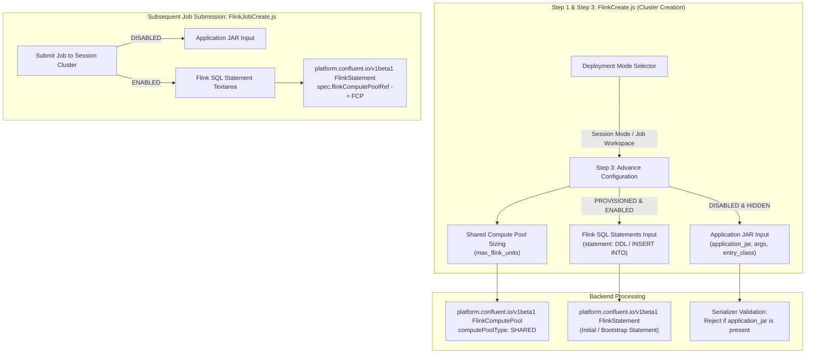

# Ticket 1: CMF Native Operator Session Mode (Shared Compute Pools & SQL Statements)

## 1. Architectural Baseline & Rules

Confluent Manager for Apache Flink (CMF) natively runs on the **Confluent for Kubernetes (CFK) Native Operator** (`platform.confluent.io/v1beta1`):

1. **Application Mode (`mode: "application"`)**:
   - Deploys a dedicated **`FlinkApplication`** custom resource.
   - Sized per job via `flink_units`.
   - Requires a packaged Java/Scala JAR (`application_jar` / `jarURI`) or Python artifact.
   - Manages its own isolated TaskManager pods and lifecycle.

2. **Session Mode (`mode: "session"`)**:
   - Deploys a shared, long-running **`FlinkComputePool`** custom resource with **`computePoolType: SHARED`**.
   - Sized via `max_flink_units` (the cluster capacity pool of TaskManager slots).
   - **Exclusively executes continuous Flink SQL statements (`FlinkStatement`)**.
   - Custom JAR applications are **NOT supported** on Shared Compute Pools by Confluent design; custom JARs must run in dedicated Application Mode (`FlinkApplication`).

3. **Advance Configuration Enforcement**:
   - **Whenever Deployment Mode is `session`**:
     - **Disable Application JAR Input**: The `application_jar` field, entry class, application arguments, and the JAR/Project source toggle must be completely **disabled and removed** from the Advance Configuration form.
     - **Provision to Accept SQL Statements**: A first-class, multiline **Flink SQL Statements** input (`statement`) must be provided in Advance Configuration, allowing users to supply initial streaming SQL queries, DDL, or continuous pipelines (e.g., `CREATE TABLE ...`, `INSERT INTO ... SELECT ...`).
   - **Whenever submitting child jobs to a CMF Session Cluster (`mode: "session-job"`)**:
     - The Application JAR input is **disabled/hidden**.
     - A dedicated **Flink SQL Statement** input is rendered for the `FlinkStatement` submission.



---

## 2. In Scope vs. Out of Scope

### In Scope
- **Advance Configuration Schema (`core/views/flink/config.py`)**:
  - In `build_config`, when `mode == "session"`:
    - Omit `application_jar`, `application_args`, `entry_class`, `python_entry_file`.
    - Provide `statement` in schema as a multiline SQL statement textarea with title `"Flink SQL Statements"`.
  - When `mode == "session-job"` and `is_cmf`:
    - Omit `application_jar`.
    - Require `statement` (Flink SQL query).
- **Backend Serializers (`core/serializers.py`)**:
  - `FlinkSerializer.validate`:
    - Allow `provider == "cmf"` with `mode == "session"`.
    - Require `max_flink_units` for CMF session clusters.
    - Strictly reject `application_jar` if passed when `mode == "session"`.
    - Accept optional initial `statement` in `advanced_configuration`.
  - `FlinkJobSerializer.validate`:
    - Strictly reject `application_jar` on CMF session jobs.
    - Require non-empty `statement`.
- **Backend Runtime Values**:
  - `core/services/flink_components.py`: Set `runtime["flink"]["mode"] = "session"`, strip `application_jar`, pass `statement` if present, size TaskManagers via `max_flink_units`.
  - `core/services/flink_job_components.py`: Set `job.provider = "cmf"`, `job.clusterName = flink.identifier`, `job.statement = adv_dict.get("statement")`.
- **Helm Charts**:
  - `charts/streamtime-flink-cfk`:
    - `templates/flink-compute-pool.yaml`: Emits `platform.confluent.io/v1beta1` `FlinkComputePool` with `computePoolType: SHARED`.
    - `templates/flink-statement.yaml`: Emits bootstrap `FlinkStatement` if `statement` is provided in session mode.
    - `templates/flink-application.yaml`: Rendered only when `mode == "application"`.
  - `charts/streamtime-flink-session-job`:
    - `templates/flinksessionjob.yaml`: Emits `platform.confluent.io/v1beta1` `FlinkStatement` when `.Values.job.provider == "cmf"`.
- **Frontend UI**:
  - `FlinkCreate.js`:
    - Unlock "Job Workspace" radio button for CMF.
    - In Advance Configuration step, whenever `mode === "session"`:
      - Hide `ApplicationSourceToggle` (JAR vs Project).
      - Ensure `application_jar` is disabled/hidden.
      - Render provision for **Flink SQL Statements** (multiline editor/textarea).
  - `FlinkJobCreate.js`:
    - Hide Application JAR and Project selector for CMF session clusters.
    - Render SQL statement textarea for session jobs.

### Out of Scope
- Server-side bytecode archive inspection for unshaded JARs (handled in [Ticket 2](file:///home/nandan-plf/.gemini/antigravity-ide/brain/8385735f-358b-4940-9dc6-fea33a43c76c/ticket_2_server_side_jar_validation.md)).
- CMF REST Artifact Management Service and `cmf://` URI scheme (handled in [Ticket 3](file:///home/nandan-plf/.gemini/antigravity-ide/brain/8385735f-358b-4940-9dc6-fea33a43c76c/ticket_3_cmf_artifact_management_service.md)).
- Advanced Monaco SQL editor with syntax highlighting, auto-complete, and schema tree (handled in [Ticket 4](file:///home/nandan-plf/.gemini/antigravity-ide/brain/8385735f-358b-4940-9dc6-fea33a43c76c/ticket_4_cmf_sql_shared_compute_pools.md)).

---

## 3. Detailed Technical Changes by File

### 3.1 Backend Configuration Schema: [`core/views/flink/config.py`](file:///home/nandan-plf/streamtime/flink-cmf-session/fleet-manager/fleet-manager-backend/core/views/flink/config.py)

Update `build_config` to govern schema generation for Advance Configuration based on `mode`:

```python
    @staticmethod
    def build_config(data, provider_id):
        """Return the {"schema", "ui_schema"} form for a draft (``mode``, ``workload``)."""
        mode = data.get("mode", "application")
        provider_key = (provider_id or data.get("workload") or "").lower()
        is_cmf = provider_key in ("cmf", "confluent", "confluent-manager-for-flink")

        required = []
        properties = {
            "parallelism": {
                "type": "integer",
                "title": "Parallelism",
                "default": 1,
                "minimum": 1,
            },
            "upgrade_mode": {
                "type": "string",
                "title": "Upgrade Mode",
                "enum": ["stateless", "savepoint", "last-state"],
                "default": "stateless",
                "description": "Flink job upgrade mode: 'stateless' restarts without state, 'savepoint' triggers a savepoint before upgrade, 'last-state' resumes from the last checkpoint.",
            },
        }

        ui_schema = {}

        if mode != "session-job":
            properties["taskmanager_replicas"] = {
                "type": "integer",
                "title": "TaskManager Replicas",
                "default": 1,
                "minimum": 1,
            }

        # --- ADVANCE CONFIGURATION RULES BY MODE ---
        if mode == "session":
            # SESSION MODE (Cluster Level):
            # 1. Disable / omit Application JAR inputs entirely.
            # 2. Provide provision to accept Flink SQL Statements.
            properties["statement"] = {
                "type": "string",
                "title": "Flink SQL Statements",
                "description": "Optional continuous streaming SQL statements or DDL to execute on the Shared Compute Pool (e.g., CREATE TABLE ..., INSERT INTO ... SELECT ...).",
            }
            ui_schema["statement"] = {
                "ui:widget": "textarea",
                "ui:options": {
                    "rows": 6,
                    "placeholder": "-- Enter continuous Flink SQL statements\nCREATE TABLE sink_table (\n  id STRING,\n  cnt BIGINT\n) WITH (\n  'connector' = 'kafka',\n  ...\n);\n\nINSERT INTO sink_table SELECT id, COUNT(*) FROM source_table GROUP BY id;",
                },
            }
        elif mode == "session-job" and is_cmf:
            # SESSION JOB (CMF):
            # 1. Disable Application JAR.
            # 2. Require Flink SQL Statement.
            properties["statement"] = {
                "type": "string",
                "title": "Flink SQL Statement",
                "description": "Continuous streaming Flink SQL statement executed on the Shared Compute Pool.",
            }
            ui_schema["statement"] = {
                "ui:widget": "textarea",
                "ui:options": {
                    "rows": 8,
                    "placeholder": "INSERT INTO sink_topic SELECT * FROM source_topic WHERE status = 'ACTIVE';",
                },
            }
            required.append("statement")
        elif mode != "session":
            # APPLICATION MODE: Application JAR input is enabled
            properties = {
                "application_jar": {
                    "type": "string",
                    "title": "Application JAR Path",
                    "description": "Path or URL to the Flink application JAR (e.g. local:///opt/flink/examples/streaming/StateMachineExample.jar).",
                },
                "entry_class": {
                    "type": "string",
                    "title": "Entry Class",
                    "description": "Optional main entrypoint class name if the JAR contains multiple main classes.",
                },
                "python_entry_file": {
                    "type": "string",
                    "title": "Python File",
                    "description": "For a Python version: the file that starts the job, relative to the top of the zip.",
                },
                "application_args": {
                    "type": "array",
                    "title": "Application Arguments",
                    "items": {"type": "string"},
                    "default": [],
                    "description": "Arguments to pass to the Flink application.",
                },
                **properties,
            }

        if mode != "session-job":
            if is_cmf:
                properties["license"] = {
                    "type": "string",
                    "title": "Confluent License Key",
                    "description": "Optional Confluent License key for CMF Flink deployments.",
                }
            properties["image"] = {
                "type": "string",
                "title": "Container Image Override",
                "description": "Optional container image URI or tag.",
            }
            properties["kafka"] = {
                "type": "string",
                "title": "Backing Kafka Cluster",
                "description": "Optional backing Kafka cluster identifier.",
            }

        properties["flink_conf"] = {
            "type": "object",
            "title": "Flink Configuration",
            "description": "Key-value overrides for flink-conf.yaml",
            "properties": {
                "state.backend": {
                    "type": "string",
                    "title": "State Backend",
                    "enum": ["hashmap", "rocksdb"],
                    "description": "The state backend to be used to store state.",
                },
            },
        }

        schema = {
            "type": "object",
            "properties": properties,
            "required": required,
        }
        return {"schema": schema, "ui_schema": ui_schema}
```

---

### 3.2 Backend Serializers: [`core/serializers.py`](file:///home/nandan-plf/streamtime/flink-cmf-session/fleet-manager/fleet-manager-backend/core/serializers.py)

#### 1. In `FlinkSerializer.validate` (Cluster Level):
- Remove restriction blocking `provider == "cmf"` and `mode == "session"` (lines 7998–8002).
- When `mode == "session"`:
  - Enforce `max_flink_units` is provided; forbid `flink_units`.
  - **Strictly reject `application_jar`**:
    ```python
    jar = adv_config.get("application_jar") if isinstance(adv_config, dict) else getattr(adv_config, "application_jar", None)
    if jar:
        raise serializers.ValidationError(
            {"advanced_configuration": {"application_jar": "Application JAR input is disabled in Session Mode. CMF session clusters run Flink SQL statements."}}
        )
    ```
  - Allow `statement` (optional SQL statement) in `advanced_configuration`.

#### 2. In `FlinkJobSerializer.validate` (Job Submission Level):
```python
        flink = self.context.get("flink")
        adv_config = attrs.get("advanced_configuration", getattr(self.instance, "advanced_configuration", None))
        jar = adv_config.get("application_jar") if isinstance(adv_config, dict) else getattr(adv_config, "application_jar", None)
        statement = adv_config.get("statement") if isinstance(adv_config, dict) else getattr(adv_config, "statement", None)

        if flink.provider == "cmf":
            if jar:
                raise serializers.ValidationError(
                    {"advanced_configuration": {"application_jar": "CMF session clusters only accept Flink SQL statements. Application JAR is disabled."}}
                )
            if not statement or not str(statement).strip():
                raise serializers.ValidationError(
                    {"advanced_configuration": {"statement": "A Flink SQL statement is required for jobs on a CMF session cluster."}}
                )
```

---

### 3.3 Backend Runtime Values Resolution

#### 1. In [`core/services/flink_components.py`](file:///home/nandan-plf/streamtime/flink-cmf-session/fleet-manager/fleet-manager-backend/core/services/flink_components.py):
In `_build_runtime_values`:
```python
        if flink.provider == "cmf" and flink.mode == "session":
            runtime["flink"]["mode"] = "session"
            # Ensure application_jar is omitted from chart values
            runtime["flink"].pop("application_jar", None)
            
            # Pass initial SQL statement if provided in Advance Configuration
            if adv_dict.get("statement"):
                runtime["flink"]["statement"] = adv_dict.get("statement")
                
            # Compute TaskManager sizing from max_flink_units
            max_fu = flink.max_flink_units or 1
            runtime["flink"]["taskmanager_replicas"] = max_fu
            runtime["flink"]["compute_pool_type"] = "SHARED"
```

#### 2. In [`core/services/flink_job_components.py`](file:///home/nandan-plf/streamtime/flink-cmf-session/fleet-manager/fleet-manager-backend/core/services/flink_job_components.py):
In `_build_runtime_values`:
```python
        if flink.provider == "cmf":
            runtime["job"]["provider"] = "cmf"
            runtime["job"]["clusterName"] = flink.identifier
            runtime["job"]["statement"] = adv_dict.get("statement", "")
            runtime["job"].pop("applicationJar", None)
```

---

### 3.4 Helm Charts

#### 1. Create `charts/streamtime-flink-cfk/templates/flink-compute-pool.yaml`:
```yaml
{{- if eq .Values.flink.mode "session" }}
apiVersion: platform.confluent.io/v1beta1
kind: FlinkComputePool
metadata:
  name: {{ .Release.Name }}
  namespace: {{ .Release.Namespace }}
  labels:
    app.kubernetes.io/name: {{ .Chart.Name }}
    app.kubernetes.io/instance: {{ .Release.Name }}
spec:
  flinkEnvironmentRef:
    name: {{ .Values.flink.flink_environment | default .Release.Name }}
  computePoolType: SHARED
  clusterSpec:
    image: {{ .Values.flink.image | quote }}
    {{- $version := .Values.flink.flink_version | default "1.19" | replace "." "_" }}
    {{- if not (hasPrefix "v" $version) }}
    {{- $version = printf "v%s" $version }}
    {{- end }}
    flinkVersion: {{ $version | quote }}
    {{- if or .Values.flink.license .Values.flink.licenseSecretRef }}
    license:
      secretRef: {{ .Values.flink.licenseSecretRef | default (printf "%s-license" .Release.Name) }}
    {{- end }}
    jobManager:
      replicas: 1
      resource:
        cpu: {{ default "1" .Values.flink.jobmanager_resources.requests.cpu | quote }}
        memory: {{ default "2Gi" .Values.flink.jobmanager_resources.requests.memory | quote }}
    taskManager:
      replicas: {{ .Values.flink.taskmanager_replicas | default 1 }}
      resource:
        cpu: {{ default "1" .Values.flink.taskmanager_resources.requests.cpu | quote }}
        memory: {{ default "2Gi" .Values.flink.taskmanager_resources.requests.memory | quote }}
    {{- if .Values.flink.flink_conf }}
    flinkConfiguration:
      {{- range $k, $v := .Values.flink.flink_conf }}
      {{ $k | quote }}: {{ $v | quote }}
      {{- end }}
    {{- end }}
{{- end }}
```

#### 2. Create `charts/streamtime-flink-cfk/templates/flink-statement.yaml`:
Deploys the initial/bootstrap SQL statement if provided in Advance Configuration:
```yaml
{{- if and (eq .Values.flink.mode "session") .Values.flink.statement }}
apiVersion: platform.confluent.io/v1beta1
kind: FlinkStatement
metadata:
  name: {{ .Release.Name }}-init-stmt
  namespace: {{ .Release.Namespace }}
  labels:
    app.kubernetes.io/name: {{ .Chart.Name }}
    app.kubernetes.io/instance: {{ .Release.Name }}
spec:
  flinkEnvironmentRef:
    name: {{ .Values.flink.flink_environment | default .Release.Name }}
  flinkComputePoolRef:
    name: {{ .Release.Name }}
  statement: {{ .Values.flink.statement | quote }}
  computePoolAllocation:
    parallelism: {{ .Values.flink.parallelism | default 1 }}
{{- end }}
```

#### 3. Guard `charts/streamtime-flink-cfk/templates/flink-application.yaml`:
```diff
- apiVersion: platform.confluent.io/v1beta1
- kind: FlinkApplication
+ {{- if eq .Values.flink.mode "application" }}
+ apiVersion: platform.confluent.io/v1beta1
+ kind: FlinkApplication
  metadata:
    name: {{ .Release.Name }}
...
+ {{- end }}
```

#### 4. Update `charts/streamtime-flink-session-job/templates/flinksessionjob.yaml`:
```yaml
{{- if eq .Values.job.provider "cmf" }}
apiVersion: platform.confluent.io/v1beta1
kind: FlinkStatement
metadata:
  name: {{ .Values.job.name | default (include "streamtime-flink-session-job.fullname" .) }}
  namespace: {{ .Release.Namespace }}
  labels:
    {{- include "streamtime-flink-session-job.labels" . | nindent 4 }}
spec:
  flinkEnvironmentRef:
    name: {{ .Values.job.environment | default .Values.job.clusterName }}
  flinkComputePoolRef:
    name: {{ .Values.job.clusterName }}
  statement: {{ .Values.job.statement | quote }}
  computePoolAllocation:
    parallelism: {{ .Values.job.parallelism | default 1 }}
{{- else }}
apiVersion: flink.apache.org/v1beta1
kind: FlinkSessionJob
...
{{- end }}
```

---

### 3.5 Frontend UI Updates

#### 1. [`FlinkCreate.js`](file:///home/nandan-plf/streamtime/flink-cmf-session/fleet-manager/fleet-manager-frontend/src/features/flink/FlinkCreate.js):

- **Enable "Job Workspace" for CMF** (lines 1421–1455):
  Remove `formik.values.workload === "cmf"` disabled check and tooltip restriction.
- **Advance Configuration Form (Step 3)**:
  - When `formik.values.mode === "session"`:
    - **Do NOT render `ApplicationSourceToggle`** (lines 1758–1779: only rendered when `mode === "application"`).
    - If `application_source` or `application_jar` exists in form values, clear/omit it on save.
    - Render the provision to accept SQL Statements via SchemaForm (`ui:widget: "textarea"` for `statement`) or fallback schema.
  - In `fallbackProps` (lines 863–885):
    ```javascript
    const fallbackProps = {
      ...(values.mode === "session" ? {
        statement: {
          type: "string",
          title: "Flink SQL Statements",
          description: "Optional continuous streaming SQL statements or DDL to execute on the Shared Compute Pool.",
        },
      } : {
        application_jar: {
          type: "string",
          title: "Application JAR Path",
        },
        application_args: {
          type: "array",
          title: "Application Arguments",
          items: { type: "string" },
          default: [],
        },
      }),
      ...(values.workload === "cmf" ? {
        license: {
          type: "string",
          title: "Confluent License Key",
        },
      } : {}),
      parallelism: { type: "integer", title: "Parallelism", default: 1 },
      taskmanager_replicas: { type: "integer", title: "TaskManager Replicas", default: 1 },
      upgrade_mode: { type: "string", title: "Upgrade Mode", enum: ["stateless", "savepoint", "last-state"], default: "stateless" },
      flink_conf: { ... },
    };
    ```

#### 2. [`FlinkJobCreate.js`](file:///home/nandan-plf/streamtime/flink-cmf-session/fleet-manager/fleet-manager-frontend/src/features/flink/FlinkJobCreate.js):

- When `flinkCluster?.provider === "cmf"`:
  - Hide the `ApplicationSourceToggle` and `application_jar` inputs.
  - Render a dedicated multiline **Flink SQL Statement** input:
    ```jsx
    {isCMF ? (
      <Box sx={{ my: 2 }}>
        <TextField
          name="statement"
          label="Flink SQL Statement"
          multiline
          rows={6}
          fullWidth
          required
          placeholder="INSERT INTO sink_topic SELECT * FROM source_topic;"
          helperText="Continuous streaming Flink SQL statement executed on the Shared Compute Pool."
          value={advancedConfig?.statement || ""}
          onChange={(e) => setAdvancedConfig((prev) => ({ ...prev, statement: e.target.value }))}
          InputProps={{ sx: { fontFamily: "monospace", fontSize: "0.9rem" } }}
        />
      </Box>
    ) : (
      /* Standard JAR / Project selector for Apache Flink */
    )}
    ```

---

## 4. Verification & Testing Matrix

| Component | Test Case | Target Assertion |
|---|---|---|
| **Backend Serializer** | Create CMF session cluster with `max_flink_units=4` | `FlinkSerializer.validate` succeeds, sets `mode="session"`. |
| **Backend Serializer** | Create CMF session cluster with `application_jar="a.jar"` | `ValidationError`: `Application JAR input is disabled in Session Mode.` |
| **Backend Serializer** | Create CMF session cluster with `statement="CREATE TABLE ..."` | `FlinkSerializer.validate` succeeds, stores `statement` in `advanced_configuration`. |
| **Backend Serializer** | Submit job to CMF session cluster with `statement="INSERT INTO ..."` | `FlinkJobSerializer.validate` succeeds. |
| **Backend Serializer** | Submit job to CMF session cluster with `application_jar="job.jar"` | `ValidationError`: `CMF session clusters only accept Flink SQL statements. Application JAR is disabled.` |
| **Config Schema API** | `POST /api/v1/workloads/flink/configuration-schema/` with `mode=session&workload=cmf` | `schema.properties.application_jar` is **absent**; `schema.properties.statement` is **present** with `ui:widget: "textarea"`. |
| **Config Schema API** | `POST /api/v1/workloads/flink/configuration-schema/` with `mode=session-job&workload=cmf` | `schema.properties.application_jar` is **absent**; `schema.properties.statement` is **required**. |
| **Helm Render** | `helm template` on `streamtime-flink-cfk` with `flink.mode=session` | Emits `FlinkComputePool` (`computePoolType: SHARED`) and omits `FlinkApplication`. |
| **Helm Render** | `helm template` on `streamtime-flink-cfk` with `flink.mode=session` and `flink.statement="INSERT INTO ..."` | Emits `FlinkComputePool` AND `FlinkStatement`. |
| **Helm Render** | `helm template` on `streamtime-flink-session-job` with `job.provider=cmf` | Emits `FlinkStatement` referencing `spec.flinkComputePoolRef`. |
| **Frontend UI** | `FlinkCreate.js` rendered with `workload="cmf"` and `mode="session"` | "Job Workspace" is selectable; Advance Configuration hides JAR toggle and displays SQL Statements field. |
| **Frontend UI** | `FlinkJobCreate.js` rendered with CMF cluster | Application JAR input is hidden; Flink SQL Statement textarea is rendered. |

---

## 5. Execution Steps for Implementation

1. **Backend Schema & Serializers**:
   - Edit `core/views/flink/config.py` to update `build_config` for `mode == "session"` and `mode == "session-job"`.
   - Edit `core/serializers.py` to lift CMF session restriction, forbid `application_jar` in session mode, and validate `statement`.
2. **Backend Runtime Components**:
   - Edit `core/services/flink_components.py` to pop `application_jar` and pass `statement` in session mode.
   - Edit `core/services/flink_job_components.py` to set `statement` and omit `applicationJar` for CMF.
3. **Helm Charts**:
   - Create `charts/streamtime-flink-cfk/templates/flink-compute-pool.yaml`.
   - Create `charts/streamtime-flink-cfk/templates/flink-statement.yaml`.
   - Guard `charts/streamtime-flink-cfk/templates/flink-application.yaml`.
   - Update `charts/streamtime-flink-session-job/templates/flinksessionjob.yaml`.
4. **Frontend UI**:
   - Edit `fleet-manager-frontend/src/features/flink/FlinkCreate.js` (radio button unlock + Advance Configuration schema & fallback).
   - Edit `fleet-manager-frontend/src/features/flink/FlinkJobCreate.js` (hide JAR, render SQL textarea).
5. **Tests**:
   - Run backend tests: `pytest core/tests/test_flink.py core/tests/views/test_flink_config.py`.
   - Run helm lint/template commands.
   - Run frontend tests: `npm test -- FlinkCreate.test.jsx`.
