# Combined Ticket 1: CMF Native Session Mode, SQL Job Submission & Server-Side Artifact Validation Engine

## 1. Context & Architectural Decisions

Following manager guidance and platform architectural alignment:
1. **Cluster Creation (`FlinkCreate.js`)**:
   - In Session Mode (`Job Workspace`), a Flink cluster represents a **shared infrastructure pool** (`platform.confluent.io/v1beta1` **`FlinkComputePool`** with `computePoolType: SHARED`).
   - Sized via `max_flink_units` (Task Manager slot pool capacity).
   - **No Workload Code at Cluster Creation**:
     - **Application JAR is disabled/hidden**: CMF Shared Compute Pools cannot run JAR files.
     - **No SQL statement submission at cluster creation**: The compute pool is created clean and bare. SQL is submitted later.
2. **Workload Submission (`FlinkJobCreate.js`)**:
   - All continuous streaming SQL workloads are submitted as **Session Jobs** (`platform.confluent.io/v1beta1` **`FlinkStatement`**).
   - For CMF session clusters:
     - The Application JAR input is **disabled/hidden**.
     - A dedicated **Flink SQL Statement** textarea is rendered.
3. **Combined Scope with Ticket 2 (Server-Side Validation Engine)**:
   - Sizing and combining Ticket 1 and Ticket 2 establishes a complete, robust boundary for CMF workloads:
     - **Java/Scala JAR Validation (`core/services/flink_jar_archive.py`)**: Server-side inspection of uploaded JARs (bytecode version, `MANIFEST.MF` `Main-Class`, and rejecting unshaded `org.apache.flink.*` core classes).
     - **Session Workload Validation**: Rejecting JAR submissions to session clusters and validating SQL statement payloads.
     - **Flink Projects SQL Foundation**: Adding `'sql'` to `ARTIFACT_KIND_CHOICES` in `core/models.py`.

```mermaid
flowchart TD
    subgraph ClusterCreation ["Cluster Creation: FlinkCreate.js"]
        ModeSelect["Select Deployment Mode: Session Mode (Job Workspace)"]
        AdvConfig["Step 3: Advance Configuration"]
        ModeSelect --> AdvConfig
        AdvConfig -->|DISABLED| NoJAR["No Application JAR Input"]
        AdvConfig -->|DEFERRED| NoSQLInit["No SQL Input at Cluster Creation"]
        AdvConfig --> PoolSizing["Configure Infrastructure:<br/>max_flink_units, flink_conf, image, license"]
        PoolSizing --> FCP["platform.confluent.io/v1beta1 FlinkComputePool<br/>computePoolType: SHARED"]
    end

    subgraph JobSubmission ["Workload Submission: FlinkJobCreate.js"]
        JobForm["Submit Job to Session Cluster"]
        JobForm -->|DISABLED| NoJobJAR["Application JAR Input Hidden"]
        JobForm -->|ENABLED| SQLField["Flink SQL Statement Input (Textarea)"]
        SQLField --> FStmt["platform.confluent.io/v1beta1 FlinkStatement<br/>spec.flinkComputePoolRef -> FCP"]
    end

    subgraph ValidationEngine ["Server-Side Validation Engine"]
        JARUpload["JAR Upload (Application Mode)"] --> JARValidator["core/services/flink_jar_archive.py<br/>- Manifest Main-Class<br/>- Bytecode Class Version (Java 17)<br/>- Shading Audit (No org.apache.flink.*)"]
        SQLSubmit["SQL Submission (Session Mode)"] --> SQLValidator["SQL Sanity Check<br/>- Non-empty statement<br/>- Reject JAR payloads"]
    end
```



---

## 2. In Scope

### Part A: CMF Native Session Cluster (Bare Compute Pool)
- **Advance Configuration Schema (`core/views/flink/config.py`)**:
  - In `build_config`, when `mode == "session"`:
    - Omit `application_jar`, `entry_class`, `application_args`, `python_entry_file`.
    - Do **not** prompt for SQL statements (cluster is created bare).
    - Provide infrastructure fields: `parallelism`, `taskmanager_replicas` (derived from FU), `license`, `image`, `kafka`, `flink_conf`.
- **Backend Serializers (`core/serializers.py`)**:
  - `FlinkSerializer.validate`:
    - Lift CMF session mode block.
    - Require `max_flink_units` (and reject `flink_units`).
    - Strictly reject `application_jar` if passed in `advanced_configuration` when `mode == "session"`.
- **Backend Runtime Values (`core/services/flink_components.py`)**:
  - Set `runtime["flink"]["mode"] = "session"`.
  - Strip `application_jar`.
  - Map `max_flink_units` to TaskManager replicas/resources and set `compute_pool_type = "SHARED"`.
- **Helm Chart (`charts/streamtime-flink-cfk`)**:
  - `templates/flink-compute-pool.yaml`: Emits `platform.confluent.io/v1beta1` `FlinkComputePool` (`computePoolType: SHARED`) when `eq .Values.flink.mode "session"`.
  - `templates/flink-application.yaml`: Guarded to render only when `eq .Values.flink.mode "application"`.
- **Frontend UI (`FlinkCreate.js`)**:
  - Unlock "Job Workspace" radio button for CMF.
  - In Step 3 (Advance Configuration):
    - Hide `ApplicationSourceToggle` when `mode === "session"`.
    - Fallback schema omits `application_jar`.

### Part B: CMF SQL Job Submission
- **Schema & Validation**:
  - In `core/views/flink/config.py`: When `mode == "session-job"` and `is_cmf`, omit `application_jar` and require `statement`.
  - In `core/serializers.py` (`FlinkJobSerializer.validate`): When parent is CMF, reject `application_jar` and require non-empty `statement`.
- **Runtime Values & Helm Chart**:
  - In `core/services/flink_job_components.py`: Set `job.provider = "cmf"`, `job.clusterName = flink.identifier`, `job.statement = adv_dict.get("statement")`.
  - In `charts/streamtime-flink-session-job/templates/flinksessionjob.yaml`: Emit `platform.confluent.io/v1beta1` `FlinkStatement` referencing `spec.flinkComputePoolRef`.
- **Frontend UI (`FlinkJobCreate.js`)**:
  - When parent is CMF: hide JAR upload and render multiline Flink SQL statement input.

### Part C: Server-Side JAR Validation Engine
- **Service (`core/services/flink_jar_archive.py`)**:
  - Inspects Java/Scala JAR archives via ZIP central directory without expanding on disk.
  - Path traversal & zip-bomb safety checks.
  - Reads `META-INF/MANIFEST.MF` to extract `Main-Class` and `Program-Class`, verifying the `.class` file exists.
  - Detects Java bytecode major class version (header `0xCAFEBABE`, bytes 6-7) to verify JVM compatibility (`52` -> Java 8, `55` -> Java 11, `61` -> Java 17, `65` -> Java 21).
  - Shading audit: Rejects JARs packaging core `org/apache/flink/*` classes (`flink-core`, `flink-streaming-java`, `flink-runtime`).
  - Connector detection (`org/apache/flink/connector/*`).
- **Integration**:
  - Schema: Add `FlinkJarManifestSchema` in `core/schemas/flink_project_schema.py`.
  - Upload Handler: Update `core/services/flink_artifact_upload.py` to spool JAR uploads up to 16 MiB for central directory inspection and persist derived manifest into `FlinkProjectVersion.manifest`.
  - Deployment Guards: Update `core/services/flink_project_deploy.py` to check Java bytecode version compatibility and entrypoint presence.

### Part D: Flink Projects SQL Foundation
- In `core/models.py`: Add `('sql', 'Flink SQL script')` to `ARTIFACT_KIND_CHOICES`.
- In `core/services/flink_artifact_upload.py`: Add `.sql` to allowed extensions under `ARTIFACT_KINDS["sql"]`.

---

## 3. Detailed Technical Changes by File

### 3.1 Backend Configuration Schema: [`core/views/flink/config.py`](file:///home/nandan-plf/streamtime/flink-cmf-session/fleet-manager/fleet-manager-backend/core/views/flink/config.py)

```python
    @staticmethod
    def build_config(data, provider_id):
        """Return the {"schema", "ui_schema"} form for a draft (``mode``, ``workload``)."""
        mode = data.get("mode", "application")
        provider_key = (provider_id or data.get("workload") or "").lower()
        is_cmf = provider_key in ("cmf", "confluent", "confluent-manager-for-flink")

        required = []
        properties = {
            "parallelism": {
                "type": "integer",
                "title": "Parallelism",
                "default": 1,
                "minimum": 1,
            },
            "upgrade_mode": {
                "type": "string",
                "title": "Upgrade Mode",
                "enum": ["stateless", "savepoint", "last-state"],
                "default": "stateless",
                "description": "Flink job upgrade mode: 'stateless' restarts without state, 'savepoint' triggers a savepoint before upgrade, 'last-state' resumes from the last checkpoint.",
            },
        }

        ui_schema = {}

        if mode != "session-job":
            properties["taskmanager_replicas"] = {
                "type": "integer",
                "title": "TaskManager Replicas",
                "default": 1,
                "minimum": 1,
            }

        # --- WORKLOAD & JAR RULES BY MODE ---
        if mode == "session":
            # BARE SESSION CLUSTER:
            # Omit Application JAR inputs entirely.
            # Do NOT prompt for SQL statements (submitted later via jobs).
            pass
        elif mode == "session-job" and is_cmf:
            # CMF SESSION JOB:
            # Disable Application JAR; require Flink SQL Statement.
            properties["statement"] = {
                "type": "string",
                "title": "Flink SQL Statement",
                "description": "Continuous streaming Flink SQL statement executed on the Shared Compute Pool.",
            }
            ui_schema["statement"] = {
                "ui:widget": "textarea",
                "ui:options": {
                    "rows": 8,
                    "placeholder": "INSERT INTO sink_topic SELECT * FROM source_topic WHERE status = 'ACTIVE';",
                },
            }
            required.append("statement")
        elif mode != "session":
            # APPLICATION MODE: Application JAR input is enabled
            properties = {
                "application_jar": {
                    "type": "string",
                    "title": "Application JAR Path",
                    "description": "Path or URL to the Flink application JAR.",
                },
                "entry_class": {
                    "type": "string",
                    "title": "Entry Class",
                    "description": "Optional main entrypoint class name.",
                },
                "python_entry_file": {
                    "type": "string",
                    "title": "Python File",
                    "description": "For a Python version: the file that starts the job.",
                },
                "application_args": {
                    "type": "array",
                    "title": "Application Arguments",
                    "items": {"type": "string"},
                    "default": [],
                },
                **properties,
            }

        if mode != "session-job":
            if is_cmf:
                properties["license"] = {
                    "type": "string",
                    "title": "Confluent License Key",
                    "description": "Optional Confluent License key for CMF Flink deployments.",
                }
            properties["image"] = {
                "type": "string",
                "title": "Container Image Override",
                "description": "Optional container image URI or tag.",
            }
            properties["kafka"] = {
                "type": "string",
                "title": "Backing Kafka Cluster",
                "description": "Optional backing Kafka cluster identifier.",
            }

        properties["flink_conf"] = {
            "type": "object",
            "title": "Flink Configuration",
            "description": "Key-value overrides for flink-conf.yaml",
            "properties": {
                "state.backend": {
                    "type": "string",
                    "title": "State Backend",
                    "enum": ["hashmap", "rocksdb"],
                    "description": "The state backend to be used to store state.",
                },
            },
        }

        schema = {
            "type": "object",
            "properties": properties,
            "required": required,
        }
        return {"schema": schema, "ui_schema": ui_schema}
```

---

### 3.2 Backend Serializers: [`core/serializers.py`](file:///home/nandan-plf/streamtime/flink-cmf-session/fleet-manager/fleet-manager-backend/core/serializers.py)

#### 1. In `FlinkSerializer.validate` (Cluster Level):
- Remove restriction blocking `provider == "cmf"` and `mode == "session"` (lines 7998–8002).
- When `mode == "session"`:
  - Enforce `max_flink_units` is set; forbid `flink_units`.
  - **Strictly reject `application_jar`**:
    ```python
    jar = adv_config.get("application_jar") if isinstance(adv_config, dict) else getattr(adv_config, "application_jar", None)
    if jar:
        raise serializers.ValidationError(
            {"advanced_configuration": {"application_jar": "Application JAR input is disabled in Session Mode. CMF session clusters run Flink SQL statements via job submissions."}}
        )
    ```

#### 2. In `FlinkJobSerializer.validate` (Job Level):
```python
        flink = self.context.get("flink")
        adv_config = attrs.get("advanced_configuration", getattr(self.instance, "advanced_configuration", None))
        jar = adv_config.get("application_jar") if isinstance(adv_config, dict) else getattr(adv_config, "application_jar", None)
        statement = adv_config.get("statement") if isinstance(adv_config, dict) else getattr(adv_config, "statement", None)

        if flink.provider == "cmf":
            if jar:
                raise serializers.ValidationError(
                    {"advanced_configuration": {"application_jar": "CMF session clusters only accept Flink SQL statements. Application JAR is disabled."}}
                )
            if not statement or not str(statement).strip():
                raise serializers.ValidationError(
                    {"advanced_configuration": {"statement": "A Flink SQL statement is required for jobs on a CMF session cluster."}}
                )
```

---

### 3.3 Server-Side JAR Validation Service: [`core/services/flink_jar_archive.py`](file:///home/nandan-plf/streamtime/flink-cmf-session/fleet-manager/fleet-manager-backend/core/services/flink_jar_archive.py) (New Service)

Inspects Java/Scala JAR archives safely by reading the ZIP central directory from a seekable stream:

```python
import io
import re
import struct
import zipfile
from typing import Dict, Any, List, Optional
from core.schemas.flink_project_schema import FlinkJarManifestSchema

MAX_UNCOMPRESSED_BYTES = 2 * 1024 * 1024 * 1024  # 2 GiB
MAX_ENTRIES = 50_000

# Bytecode versions: 52 = Java 8, 55 = Java 11, 61 = Java 17, 65 = Java 21
BYTECODE_MAP = {52: "8", 55: "11", 61: "17", 65: "21"}

FORBIDDEN_SHADED_PACKAGES = (
    "org/apache/flink/core/",
    "org/apache/flink/streaming/api/",
    "org/apache/flink/runtime/",
    "org/apache/flink/table/api/",
)

def inspect_flink_jar_archive(fp: io.BufferedIOBase) -> FlinkJarManifestSchema:
    """Inspects a JAR archive without extracting to disk."""
    if not zipfile.is_zipfile(fp):
        raise ValueError("File is not a valid ZIP/JAR archive.")

    fp.seek(0)
    with zipfile.ZipFile(fp, "r") as zf:
        infolist = zf.infolist()
        if len(infolist) > MAX_ENTRIES:
            raise ValueError(f"JAR exceeds maximum entry limit ({len(infolist)} > {MAX_ENTRIES}).")

        total_size = sum(info.file_size for info in infolist)
        if total_size > MAX_UNCOMPRESSED_BYTES:
            raise ValueError("JAR uncompressed size exceeds limit (potential zip bomb).")

        main_class = None
        program_class = None
        max_bytecode = 0
        total_classes = 0
        detected_connectors = set()
        class_files = set()

        for info in infolist:
            name = info.filename
            if name.startswith("/") or ".." in name or "\\" in name:
                raise ValueError(f"Path traversal detected in archive: {name}")

            if name == "META-INF/MANIFEST.MF":
                manifest_data = zf.read(info).decode("utf-8", errors="replace")
                main_class = _extract_manifest_key(manifest_data, "Main-Class")
                program_class = _extract_manifest_key(manifest_data, "Program-Class")

            elif name.endswith(".class"):
                total_classes += 1
                class_files.add(name)

                # Shading audit: Detect bundled core Flink classes
                for forbidden in FORBIDDEN_SHADED_PACKAGES:
                    if name.startswith(forbidden):
                        raise ValueError(
                            f"The uploaded JAR contains bundled core Flink class '{name}'. "
                            "Mark Flink dependencies as 'provided' in your build configuration."
                        )

                # Connector detection
                if name.startswith("org/apache/flink/connector/"):
                    parts = name.split("/")
                    if len(parts) > 4:
                        detected_connectors.add(parts[4])

                # Bytecode check on sample of classes
                if max_bytecode < 65 and total_classes <= 200:
                    with zf.open(info) as cf:
                        magic = cf.read(4)
                        if magic == b"\xca\xfe\xba\xbe":
                            _minor, major = struct.unpack(">HH", cf.read(4))
                            if major > max_bytecode:
                                max_bytecode = major

        # If Main-Class specified, verify presence
        if main_class:
            expected_class = main_class.replace(".", "/") + ".class"
            if expected_class not in class_files:
                raise ValueError(f"Manifest specifies Main-Class '{main_class}', but class file was not found in JAR.")

        java_ver = BYTECODE_MAP.get(max_bytecode, f"Java-bytecode-{max_bytecode}")
        return FlinkJarManifestSchema(
            main_class=main_class,
            program_class=program_class,
            bytecode_version=max_bytecode or 61,
            java_version=java_ver,
            detected_connectors=sorted(list(detected_connectors)),
            total_classes=total_classes,
        )

def _extract_manifest_key(manifest_str: str, key: str) -> Optional[str]:
    match = re.search(rf"^{key}:\s*(.+)$", manifest_str, re.MULTILINE | re.IGNORECASE)
    return match.group(1).strip() if match else None
```

---

### 3.4 Helm Charts

#### 1. `charts/streamtime-flink-cfk/templates/flink-compute-pool.yaml`:
```yaml
{{- if eq .Values.flink.mode "session" }}
apiVersion: platform.confluent.io/v1beta1
kind: FlinkComputePool
metadata:
  name: {{ .Release.Name }}
  namespace: {{ .Release.Namespace }}
  labels:
    app.kubernetes.io/name: {{ .Chart.Name }}
    app.kubernetes.io/instance: {{ .Release.Name }}
spec:
  flinkEnvironmentRef:
    name: {{ .Values.flink.flink_environment | default .Release.Name }}
  computePoolType: SHARED
  clusterSpec:
    image: {{ .Values.flink.image | quote }}
    {{- $version := .Values.flink.flink_version | default "1.19" | replace "." "_" }}
    {{- if not (hasPrefix "v" $version) }}
    {{- $version = printf "v%s" $version }}
    {{- end }}
    flinkVersion: {{ $version | quote }}
    {{- if or .Values.flink.license .Values.flink.licenseSecretRef }}
    license:
      secretRef: {{ .Values.flink.licenseSecretRef | default (printf "%s-license" .Release.Name) }}
    {{- end }}
    jobManager:
      replicas: 1
      resource:
        cpu: {{ default "1" .Values.flink.jobmanager_resources.requests.cpu | quote }}
        memory: {{ default "2Gi" .Values.flink.jobmanager_resources.requests.memory | quote }}
    taskManager:
      replicas: {{ .Values.flink.taskmanager_replicas | default 1 }}
      resource:
        cpu: {{ default "1" .Values.flink.taskmanager_resources.requests.cpu | quote }}
        memory: {{ default "2Gi" .Values.flink.taskmanager_resources.requests.memory | quote }}
    {{- if .Values.flink.flink_conf }}
    flinkConfiguration:
      {{- range $k, $v := .Values.flink.flink_conf }}
      {{ $k | quote }}: {{ $v | quote }}
      {{- end }}
    {{- end }}
{{- end }}
```

#### 2. `charts/streamtime-flink-session-job/templates/flinksessionjob.yaml`:
```yaml
{{- if eq .Values.job.provider "cmf" }}
apiVersion: platform.confluent.io/v1beta1
kind: FlinkStatement
metadata:
  name: {{ .Values.job.name | default (include "streamtime-flink-session-job.fullname" .) }}
  namespace: {{ .Release.Namespace }}
  labels:
    {{- include "streamtime-flink-session-job.labels" . | nindent 4 }}
spec:
  flinkEnvironmentRef:
    name: {{ .Values.job.environment | default .Values.job.clusterName }}
  flinkComputePoolRef:
    name: {{ .Values.job.clusterName }}
  statement: {{ .Values.job.statement | quote }}
  computePoolAllocation:
    parallelism: {{ .Values.job.parallelism | default 1 }}
{{- else }}
apiVersion: flink.apache.org/v1beta1
kind: FlinkSessionJob
...
{{- end }}
```

---

### 3.5 Frontend UI Updates

#### 1. [`FlinkCreate.js`](file:///home/nandan-plf/streamtime/flink-cmf-session/fleet-manager/fleet-manager-frontend/src/features/flink/FlinkCreate.js):
- Unlock "Job Workspace" for CMF (remove disabled state and tooltip restriction).
- In Step 3 (Advance Configuration):
  - Do NOT render `ApplicationSourceToggle` when `mode === "session"`.
  - Fallback schema omits `application_jar` when `mode === "session"`.
  - Cluster is saved cleanly without prompting for SQL statements.

#### 2. [`FlinkJobCreate.js`](file:///home/nandan-plf/streamtime/flink-cmf-session/fleet-manager/fleet-manager-frontend/src/features/flink/FlinkJobCreate.js):
- When `flinkCluster?.provider === "cmf"`:
  - Hide JAR upload and Project selector.
  - Render dedicated multiline Flink SQL Statement textarea with monospace font.

---

## 4. Verification & Testing Matrix

| Component | Test Case | Target Assertion |
|---|---|---|
| **Cluster Serializer** | Create CMF session cluster with `max_flink_units=4` | `FlinkSerializer.validate` succeeds, sets `mode="session"`. |
| **Cluster Serializer** | Create CMF session cluster with `application_jar="app.jar"` | `ValidationError`: `Application JAR input is disabled in Session Mode.` |
| **Job Serializer** | Submit job to CMF session cluster with `statement="INSERT INTO ..."` | `FlinkJobSerializer.validate` succeeds, resolves `FlinkStatement`. |
| **Job Serializer** | Submit job to CMF session cluster with `application_jar="job.jar"` | `ValidationError`: `CMF session clusters only accept Flink SQL statements.` |
| **Config Schema API** | Call configuration-schema with `mode=session&workload=cmf` | `properties.application_jar` is **absent**; no `statement` prompt at cluster creation. |
| **Config Schema API** | Call configuration-schema with `mode=session-job&workload=cmf` | `properties.application_jar` is **absent**; `properties.statement` is **required**. |
| **JAR Validator** | Inspect synthetic JAR with `Main-Class` present | Returns valid `FlinkJarManifestSchema` with bytecode version and main class. |
| **JAR Validator** | Inspect JAR with unshaded `org.apache.flink.core.*` | Raises `ValueError`: bundled core Flink class detected. |
| **Helm Render** | `helm template` on `streamtime-flink-cfk` with `flink.mode=session` | Emits `FlinkComputePool` (`computePoolType: SHARED`) and omits `FlinkApplication`. |
| **Helm Render** | `helm template` on `streamtime-flink-session-job` with `job.provider=cmf` | Emits `FlinkStatement` referencing `spec.flinkComputePoolRef`. |
